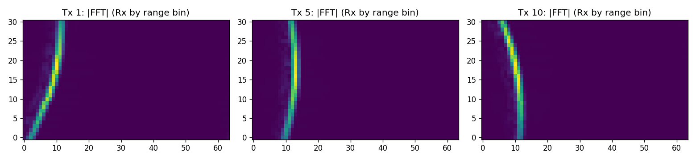
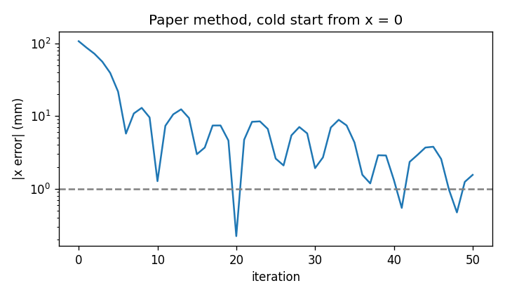
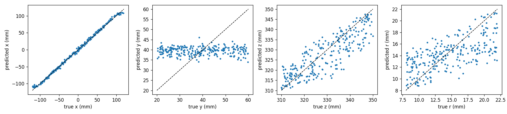
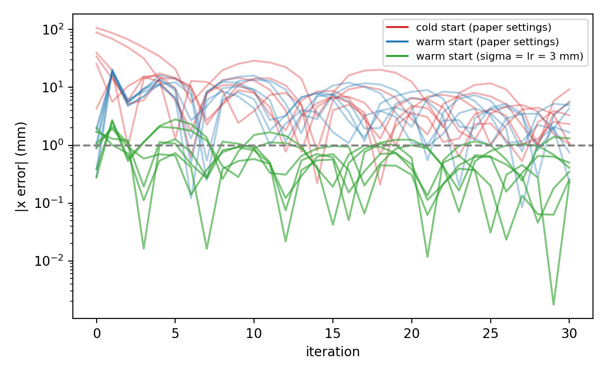

# Learned warm starts and 8 bit inference for THz MIMO-SAR inverse simulation

Md Forhadul Islam, London

This is a small study I did on top of the paper by Saleh, Kahl, Haring Bolívar and Kolb, *Direct Detection of Object Parameters From Raw Data in MIMO-SAR Imaging at 235 to 270 GHz via Inverse Simulation* (IEEE Journal of Microwaves, 2026, [doi:10.1109/JMW.2025.3627070](https://doi.org/10.1109/JMW.2025.3627070)), using their public code [InverseThzSim](https://github.com/memamsaleh/InverseThzSim).

Their method estimates the position and size of an object directly from the raw radar data by matching a differentiable simulation to the measurement. Each step needs a few full simulations and the position search starts from a fixed value. I wanted to see two things:

1. Can a small network, trained only on data from their simulator, give the optimization a good starting point?
2. Does that network still work after 8 bit quantization, so that it could one day run next to the sensor?

I did not have access to the measured data, so everything here is on simulated data.

The short report is in [`report/Islam_THz_MIMO-SAR_Warm_Start_Report.pdf`](report/Islam_THz_MIMO-SAR_Warm_Start_Report.pdf).

## What I did

| Step | Notebook | What it does |
|---|---|---|
| 0 | `00_common.ipynb` | Shared code: paths, loading the InverseThzSim modules, scene builder, features, network |
| 1 | `01_setup_check_and_calibration.ipynb` | Checks Mitsuba on the GPU, simulates the calibration plane, times one simulation |
| 2 | `02_reproduce_paper_1D.ipynb` | Reproduces the x position search of the paper on a simulated sphere |
| 3 | `03_generate_synthetic_dataset.ipynb` | Simulates 5100 spheres at random positions and sizes |
| 4 | `04_train_one_shot_predictor.ipynb` | Trains the CNN estimator, including a batch norm recalibration step |
| 5 | `05_warm_start_vs_cold_start.ipynb` | Cold start (x = 0) against warm start with the paper's settings |
| 5b | `05b_warm_start_adapted_step.ipynb` | Warm start with a 3 mm step size |
| 6 | `06_quantise_8bit.ipynb` | INT8 post training quantization, INT4 weight test |
| 6b | `06b_quantisation_diagnostics.ipynb` | Bias, error correlation of z and r, front surface distance |
| 7 | `07_results_summary.ipynb` | Collects the numbers from `outputs/results` |

All notebooks are saved with their outputs, so you can read them without running anything. Every number in the report comes from the JSON files in `outputs/results`.

## Setup

* Windows 11, NVIDIA RTX 3090, Anaconda, Python 3.11
* PyTorch 2.5.1 (CUDA 12.1), NumPy 1.26.4, Mitsuba 3.3.0 (the same version as the paper)
* The paper used a source build of Mitsuba with monochromatic variants. The binary release of 3.3.0 only has RGB variants, so I used `cuda_ad_rgb`.
* One simulation with calibration takes about 4 s on the RTX 3090.

To run it yourself:

```
scripts\setup_env.bat              creates the conda env "kolb" and clones InverseThzSim into this folder
set KOLB_PROJECT=<path to this repository>
scripts\run_nb.bat 01_setup_check_and_calibration
```

The simulated dataset (about 175 MB) is not in the repository. Notebook 03 regenerates it with fixed seeds; `scripts\run_gen.bat 3 6` runs three generators in parallel for up to 6 hours.

## Results

### Simulator check and reproduction

The input of the estimator is the magnitude of the windowed range profile for each transmitter and receiver. For one sphere it looks like this:



Running the paper's position search from x = 0 on a simulated sphere at x = −107.75 mm, the best estimate after 50 iterations was 0.22 mm from the true value.



### Estimator

5100 simulated spheres, split 90/5/5 (4590 training, 255 test). Test mean absolute error in mm:

| Model | x | y | z | r | front surface z − 2r |
|---|---|---|---|---|---|
| Always predict the mean | 58.4 | 10.2 | 10.2 | 3.7 | 12.1 |
| CNN, FP32 | 2.8 | 10.2 | 5.1 | 2.6 | 1.2 |
| CNN, INT8 | 2.9 | 10.2 | 5.1 | 2.6 | 1.2 |
| CNN, INT4 weights | 3.4 | 10.2 | 5.1 | 2.6 | |



* The lateral position x is estimated well, in 0.36 ms per prediction.
* z and r are hard to separate on their own (their errors correlate at 0.99), but the front surface distance z − 2r is estimated to 1.2 mm. In the scene convention of the code the sphere center is at z − r, so the surface facing the array is at z − 2r.
* y is not better than the mean. With magnitude range profiles from two parallel linear arrays this is what I expected.
* INT8 changes the errors by at most 0.1 mm and makes the weights four times smaller (3447 kB to 862 kB).

A mistake I made on the way: in my first training run the network had a constant offset of about 3 mm in z and r. The batch norm statistics had been collected on noisy inputs. Recomputing them on clean training inputs fixed the offset.

### Warm start

Same 6 test spheres, 30 iterations each, only x optimized (y, z and r known), as in the 1D experiments of the paper. Lateral error in mm:

| Start | After 5 iterations (median) | Last iteration, median (IQR) | Lowest loss iterate (median) |
|---|---|---|---|
| Cold, x = 0, paper settings | 11.9 | 2.80 (1.37 to 4.91) | 0.75 |
| Warm, paper settings | 9.2 | 3.01 (0.98 to 4.78) | 0.24 |
| Warm, step size 3 mm | 1.2 | 0.38 (0.28 to 0.48) | 0.016 |



The estimator starts within 0.3 to 2.0 mm of the true position, but with the paper's learning rate (20 mm) the first Adam steps move it away again. With the step size reduced to about the error of the estimator, it stays close. I only tuned the step size for the warm start, not for the cold start, so this is not a fair tuned comparison. The lowest loss values are very small because the reference comes from the same noise free simulator, so I do not read them as real precision.

## Limitations

* Simulated data only. The measured data of the paper is on [IEEE DataPort](https://doi.org/10.21227/8jb1-x962) and would be the real test.
* Spheres only, 6 warm start cases, one training seed, 1D search with the other parameters known.
* Quantization is simulated in PyTorch, so it shows accuracy, not speed or power.
* RGB instead of monochromatic Mitsuba variant, 30 instead of 50 iterations.

## Next steps I would like to try

* Run the estimator and the warm start on the measured spheres from IEEE DataPort.
* A fairer baseline: cold start with a tuned or decaying step size, on 30 or more spheres.
* Different random seeds for the reference and the estimate plus added noise, and a search over x, z and r together.

## Credits

The simulator, the loss and the optimizer are from [InverseThzSim](https://github.com/memamsaleh/InverseThzSim) by Mohamed Saleh et al. (MIT licence). This repository only adds the notebooks for the estimator, the warm start experiments and the quantization study. It does not include their code; `scripts\setup_env.bat` clones it.
